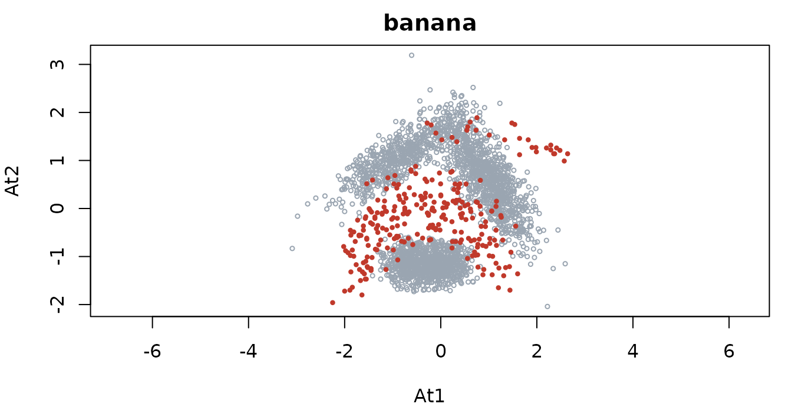
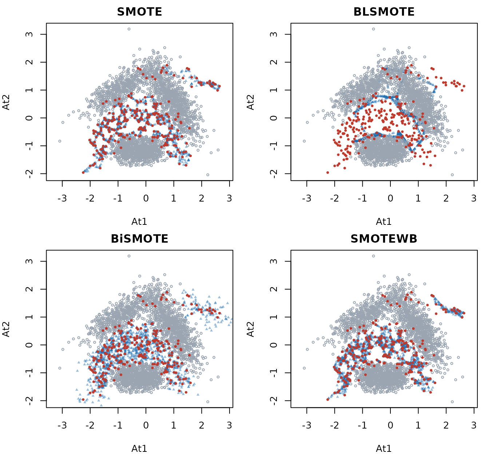
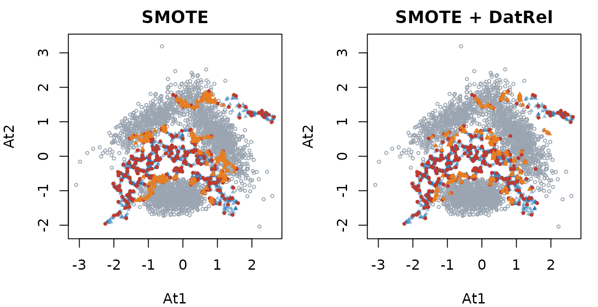

# Getting started with imbalanceKit

`imbalanceKit` brings resampling methods, performance metrics and data
complexity measures for imbalanced classification together. This article
walks through a typical workflow on the `banana` data: look at the
problem, resample, post-process the synthetic samples with DatRel, and
check whether it helps a classifier.

``` r

library(imbalanceKit)
```

## The data

`banana` is a two-dimensional data set with a minority (`positive`)
class that overlaps with the majority class. It contains the usual
difficulties of imbalanced data: a small minority class, class overlap,
noise and small disjuncts.

``` r

x <- banana[, c("At1", "At2")]
y <- banana$Class
table(y)
#> y
#> negative positive 
#>     2376      264
```

All resamplers take a numeric feature matrix (or data frame) `x` and a
factor class variable `y`. A small helper for the plots of this article:

``` r

col_neg <- "#9aa5b1"
col_pos <- "#c0392b"
col_syn <- "#1f6fb2"

plot_classes <- function(x, y, x_syn = NULL, main = "") {
  x <- as.matrix(x)
  plot(x, type = "n", xlab = "At1", ylab = "At2", main = main, asp = 1)
  if (!is.null(x_syn)) {
    points(as.matrix(x_syn), col = adjustcolor(col_syn, 0.45), pch = 17, cex = 0.5)
  }
  neg <- y != "positive"
  points(x[neg, , drop = FALSE], col = col_neg, pch = 1, cex = 0.5)
  points(x[!neg, , drop = FALSE], col = col_pos, pch = 16, cex = 0.6)
}

par(mar = c(4, 4, 2, 1))
plot_classes(x, y, main = "banana")
```



## How hard is the problem?

[`complexity()`](https://fatihsaglam.github.io/imbalanceKit/reference/complexity.md)
measures class imbalance, class overlap and noise. Every measure is also
available as its own function, for example
[`complexity_IR()`](https://fatihsaglam.github.io/imbalanceKit/reference/complexity_measures.md).

``` r

complexity(x, y, measures = c("IR", "R", "R_aug", "N1", "N3", "N4"), seed = 1)
#>         IR          R      R_aug         N1         N3         N4 
#> 9.00000000 0.03750000 0.27689394 0.08219697 0.05757576 0.25000000
```

`IR` is the imbalance ratio. `R` and `R_aug` describe how much of the
data lies in the overlap region, and `R_aug` weighs the classes by their
sizes so that the minority class is not drowned. `N1`, `N3` and `N4` are
neighbourhood based measures of class overlap and noise. See
[`?complexity_measures`](https://fatihsaglam.github.io/imbalanceKit/reference/complexity_measures.md)
for all of them.

## Oversampling

[`SMOTE()`](https://fatihsaglam.github.io/imbalanceKit/reference/SMOTE.md)
creates synthetic minority samples between neighbouring minority
samples. The result is a list.

``` r

set.seed(1)
m <- SMOTE(x, y)
names(m)
#> [1] "x_new" "y_new" "x_syn" "y_syn"
table(m$y_new)
#> 
#> negative positive 
#>     2376     2376
```

`x_new` and `y_new` are the original data plus the synthetic samples,
which are also returned alone as `x_syn` and `y_syn`. `ovRate = 1` (the
default) balances the classes; a smaller value generates fewer samples.

Methods of this package can be swapped freely because they share the
interface. Here are four of them on the same data (minority samples in
red, synthetic samples in blue):

``` r

set.seed(1)
res <- list(
  SMOTE    = SMOTE(x, y),
  BLSMOTE  = BLSMOTE(x, y),
  BiSMOTE  = BiSMOTE(x, y),
  SMOTEWB  = SMOTEWB(x, y)
)

par(mfrow = c(2, 2), mar = c(4, 4, 2, 1))
for (nm in names(res)) {
  plot_classes(x, y, res[[nm]]$x_syn, main = nm)
}
```



The methods differ mainly in where they place the samples; the overlap
region between the classes is where they differ most.

## Post-processing with DatRel

DatRel is not a resampler by itself: it takes samples from **any**
source and moves the ones that fall outside the region of their class
back into it. The region is a set of balls, centred at a few dominating
samples, that do not contain a sample of another class.

``` r

set.seed(1)
m <- SMOTE(x, y)
d <- DatRel(x, y, x_syn = m$x_syn, y_syn = m$y_syn)
d$n_relocated
#> $positive
#> [1] 295
```

295 of the 2112 synthetic samples were outside the minority region and
were relocated. The plot shows those samples (orange) before and after
the relocation:

``` r

moved <- rowSums(abs(m$x_syn - d$x_syn)) > 0

par(mfrow = c(1, 2), mar = c(4, 4, 2, 1))
plot_classes(x, y, m$x_syn[!moved, ], main = "SMOTE")
points(m$x_syn[moved, ], col = "#e67e22", pch = 17, cex = 0.6)
plot_classes(x, y, d$x_syn[!moved, ], main = "SMOTE + DatRel")
points(d$x_syn[moved, ], col = "#e67e22", pch = 17, cex = 0.6)
```



[`oversampleDatRel()`](https://fatihsaglam.github.io/imbalanceKit/reference/oversampleDatRel.md)
does both steps with a base method of your choice, for example
`oversampleDatRel(x, y, method = "BiSMOTE")`.

## Does it help a classifier?

Resampling is only applied to the training data. Here a decision tree is
trained on the original training data, on SMOTE and on SMOTE + DatRel,
and compared on held-out test data over 10 random stratified splits.
[`evaluate()`](https://fatihsaglam.github.io/imbalanceKit/reference/evaluate.md)
calculates several metrics at once.

``` r

split_data <- function(y, p_train = 0.7) {
  idx <- unlist(lapply(split(seq_along(y), y), function(i) {
    i[sample.int(length(i), round(p_train * length(i)))]
  }))
  sort(idx)
}

fit_eval <- function(x_train, y_train, x_test, y_test) {
  fit <- rpart::rpart(y ~ ., data = data.frame(x_train, y = y_train))
  pred <- predict(fit, data.frame(x_test), type = "class")
  evaluate(y_test, y_pred = pred, positive = "positive",
           metrics = c("BACC", "GMEAN", "F1", "MCC"))
}

set.seed(2026)
results <- lapply(1:10, function(r) {
  i_train <- split_data(y)
  x_tr <- x[i_train, ]; y_tr <- y[i_train]
  x_te <- x[-i_train, ]; y_te <- y[-i_train]

  s <- SMOTE(x_tr, y_tr)
  d <- DatRel(x_tr, y_tr, s$x_syn, s$y_syn)

  rbind(
    original         = fit_eval(x_tr, y_tr, x_te, y_te),
    SMOTE            = fit_eval(s$x_new, s$y_new, x_te, y_te),
    `SMOTE + DatRel` = fit_eval(d$x_new, d$y_new, x_te, y_te)
  )
})

round(Reduce(`+`, results) / length(results), 3)
#>                 BACC GMEAN    F1   MCC
#> original       0.814 0.796 0.695 0.667
#> SMOTE          0.859 0.858 0.599 0.569
#> SMOTE + DatRel 0.860 0.859 0.601 0.573
```

The table shows the mean of the 10 splits. Balancing the classes raises
the metrics that treat both classes equally (`BACC`, `GMEAN`) but can
lower `F1` and `MCC`, because more majority samples are classified as
positive. Which method wins depends on the data and the classifier, so
compare several methods and several classifiers on your own problem; the
metrics of
[`evaluate()`](https://fatihsaglam.github.io/imbalanceKit/reference/evaluate.md)
are described in
[`?metrics`](https://fatihsaglam.github.io/imbalanceKit/reference/metrics.md).

## Where to go next

- [`?UGO`](https://fatihsaglam.github.io/imbalanceKit/reference/UGO.md)
  uses a base method together with a classifier and generates samples
  where the classifier is uncertain.
- [`?MCSMOTE`](https://fatihsaglam.github.io/imbalanceKit/reference/MCSMOTE.md)
  handles more than two classes with a transition matrix.
- All oversamplers work with more than two classes (one-versus-rest).
- The reference page lists all methods by year of publication.
